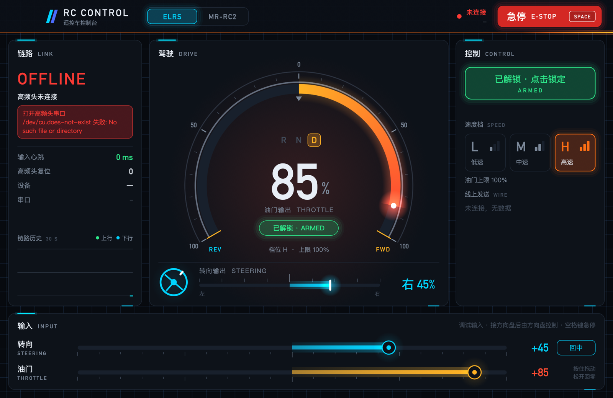

# rc-control

电脑端遥控车控制程序：电脑通过 ExpressLRS 高频头发 CRSF 控制车，同时用内置图传接收 OpenIPC 摄像头画面。

| 高频头 | 接法 | 配置 |
|---|---|---|
| Jumper AION Nano（USB 已改为 CRSF 串口） | 直接插 USB | `port = "auto"`，115200，20 ms |
| BETAFPV Micro TX 等外置高频头 | USB 转串口模块 TXD → 高频头 CRSF 脚（3.3 V 电平） | 写死端口，400000，4 ms |

界面是原生窗口（egui），深色仪表盘风格：中间是油门仪表和转向条（有图传时切成画面），左边是链路状态、图传网卡和 30 秒链路历史，右边是解锁、速度档、方向反转和线上发送的值。可以用窗口滑条或 Thrustmaster T300RS 方向盘操作。



## 运行

```bash
cargo build --release
./target/release/rc-control              # 打开控制窗口
./target/release/rc-control --list-ports # 看串口和 USB 编号
```

配置：复制 `rc-control.example.toml` 为 `rc-control.toml`，放在当前目录或程序旁边。不放就用默认值。串口默认 `auto`，按 USB 芯片编号找 AION Nano 的 CH9102（`1a86:55d4`）；经 USB 转串口模块接的高频头要在 `[elrs]` 里写明端口和波特率。

只接了 TXD（没有 RXD 回传线）时，程序收不到高频头的回复，左边会显示 **TX ONLY**：控制照常，只是读不到链路质量。

**macOS 上 `cargo build` 报 Xcode 许可证错误时：** 在终端运行一次 `sudo xcodebuild -license` 同意许可，或者临时改用命令行工具编译：`DEVELOPER_DIR=/Library/Developer/CommandLineTools cargo build --release`。

## Windows

在 Windows 上用 MSYS2 UCRT64 工具链构建（等价于 macOS 的 Homebrew 环境方案）：

1. 安装 MSYS2 到 `C:\msys64`，然后装一套依赖（git bash 或 PowerShell 里跑一次）：

   ```
   C:\msys64\usr\bin\pacman.exe -S --noconfirm mingw-w64-ucrt-x86_64-gcc mingw-w64-ucrt-x86_64-cmake mingw-w64-ucrt-x86_64-ninja mingw-w64-ucrt-x86_64-pkgconf mingw-w64-ucrt-x86_64-clang mingw-w64-ucrt-x86_64-llvm mingw-w64-ucrt-x86_64-libusb mingw-w64-ucrt-x86_64-libsodium mingw-w64-ucrt-x86_64-ffmpeg mingw-w64-ucrt-x86_64-rust
   ```

2. 以后构建直接用：

   ```powershell
   powershell -ExecutionPolicy Bypass -File scripts\build.ps1 --release
   ```

   得到 `target\release\rc-control.exe`。这个脚本负责设置 UCRT64 的 PATH、pkg-config、CMake(Ninja) 和 libclang 环境。国内网络建议把 `%USERPROFILE%\.cargo\config.toml` 的 crates.io 源换成国内镜像。

3. 发布前把 FFmpeg/libusb/libsodium 的 DLL 部署到 exe 旁（不再需要 MSYS2 环境）：

   ```powershell
   powershell -ExecutionPolicy Bypass -File scripts\deploy-dlls.ps1
   ```

   Release 版双击运行不会弹出黑色命令行窗口。界面用系统自带的微软雅黑显示中文。

关于本仓库的 Windows 相关改动：

- `vendor/ffmpeg-sys-next-9.0.1`：bindgen 解析 `<d3d11.h>` 会把 `amxintrin.h` 的 `__tile1024i_str` 带进来，`packed`+`align` 冲突在 rustc 下编译不过（E0058/E0080），已在 `hwcontext_stubs` 补 d3d11/d3d12/d3d9/dxva2 空 stub，经 `[patch.crates-io]` 使用（报错形态是 E0587/E0080）。
- Aviateur 的两处 MinGW 兼容修正（子模块源码不改，构建时打在复制出来的文件上，见 `native/CMakeLists.txt` 的 `patch_staged`）：`net_compat.h` 里 MinGW 已带 `clock_gettime`（winpthreads），内联版本只对非 MinGW 生效；`compat/getopt.h` 里 getopt 全局变量的 weak 定义在 PE 链接器下会重复，MinGW 下不提供。
- `native/CMakeLists.txt`：`/utf-8` 只对 MSVC 生效；`build.rs` 为 MinGW 链接静态 libstdc++/gcc_eh 和 ws2_32。

- CH9102（高频头）如果设备管理器里没有出现 COM 口，要装 WCH 的 CH343SER 驱动。
- 配置里也可以把端口写死成 `COM5` 这样的名字。
- 图传网卡（RTL8812AU）在 Windows 上必须绑定 WinUSB/libusbK 驱动，Realtek 的 Wi-Fi 驱动（RtlWlanu）打不开 USB。可以用 Zadig 替换，或直接用仓库里的脚本（会弹 UAC 确认）：

  ```powershell
  powershell -ExecutionPolicy Bypass -File scripts\bind-8812au-winusb.ps1
  ```

  绑定后系统里不再有这块"Wi-Fi 网卡"，属于预期。脚本执行前会把原注册表导出到 `scripts\rtl8812au-before-winusb-<时间>.reg`，想还原回 Realtek 驱动时双击它，再拔插网卡。绑定检查：`Get-PnpDevice | ? InstanceId -match 'VID_0BDA'` 的 Service 应为 `WinUSB`。

## 图传

程序在 UDP `5600`（配置 `[video]`）接收 RTP 视频（默认 H.265，也支持 H.264），用 FFmpeg 解码。收到画面时，中间面板切到图传样式：上方状态条，中间是原比例画面，下方是油门和转向；超过 1 秒没有画面，就自动切回仪表盘。

**内置图传接收（`[radio]`）：** 程序直接驱动 RTL8812AU 这类 USB 网卡收 OpenIPC 图传，不需要再开 Aviateur。收包部分就是 Aviateur 的代码（devourer 用户态驱动 + wfb-ng），以子模块形式放在 `third_party/aviateur`，原样编译，只把它的界面接口换成 `native/gui_interface.h`。左边面板的「图传 RADIO」显示网卡、信道和链路质量。

- 默认信道 161（5805 MHz）、20 MHz、OpenIPC 默认密钥，要和摄像头一致。
- 和外部 Aviateur 不能同时用：两边会抢同一块网卡和 UDP 8001。
- 网卡卡死、连续几次启动失败时，界面会提示拔插网卡。
- 对上游的一处修正：Aviateur 停止链路后不会关闭 UDP 8001，同一进程里再次启动会直接崩溃。构建时会给复制出来的 `tx_frame.cpp` 补上关闭代码（见 `native/CMakeLists.txt`），子模块里的源码保持不动。

也可以继续用外部 Aviateur：把 `[radio] enabled` 设成 `false`，在 Aviateur 里打开 Forward RTP，端口设成 5600。

```bash
./target/release/rc-control --probe-video   # 只收图传 10 秒，打印码率、帧率、解码耗时
```

没有摄像头时，可以用 FFmpeg 推测试画面：

```bash
ffmpeg -re -f lavfi -i testsrc2=size=1280x720:rate=60 -c:v libx265 -preset ultrafast -tune zerolatency -x265-params keyint=30:repeat-headers=1 -f rtp -pkt_size 1400 rtp://127.0.0.1:5600
```

**获取源码：** 克隆后要拉取 Aviateur 子模块（只需要它的 devourer，不用拉 SDL 等）：

```bash
git submodule update --init third_party/aviateur
git -C third_party/aviateur submodule update --init 3rd/devourer
```

**依赖：** 编译需要 CMake、libusb、libsodium 和 FFmpeg 开发库（macOS 上 `brew install cmake libusb libsodium ffmpeg`）。现在程序动态链接 Homebrew 的 FFmpeg；Homebrew 升级 FFmpeg 大版本后，要重新 `cargo build`。正式分发前要把 FFmpeg 库一起打包。

## 方向盘

接上 Thrustmaster T300RS（基座 044f:b66e）就自动接管转向和油门：油门踏板减刹车踏板得到油门量，直接读 HID 报告，不需要官方驱动。250 ms 没有新数据（拔线）时回到窗口滑条，油门照常回零。配置在 `[wheel]`。

```bash
./target/release/rc-control --probe-wheel   # 记录方向盘/踏板的 HID 报告，按提示操作，生成 wheel-trace.csv
```

另一个排查命令：`--probe-elrs`（开高频头串口发 250 帧中位 CRSF，并打印收到的回复）。

## 安全规则

全部集中在 `src/control.rs`，后端绕不过去：

- 启动时油门锁定。解锁要求输入心跳正常、油门在中位。
- 输入超过 `heartbeat_timeout_ms`（默认 300 ms）没更新：输出立即回中，油门锁定。之后输入恢复了也不会自动解锁，必须重新解锁。窗口每一帧都发心跳，最小化或卡住时心跳就会断。
- 油门滑条只有按住鼠标拖动时才保持，松开立即回零。
- 急停：锁定并让转向、油门回中。窗口里按空格键也是急停，而且空格不会触发任何按钮。
- 关闭窗口或 Ctrl+C 退出时，都会先归零、发几帧中位，再关串口和图传网卡。

程序被强制结束（kill -9、断电、蓝屏）时也是安全的：高频头收不到数据就停止发射，接收机触发失控保护，车会停。

## 结构

```
src/
  control.rs        与方案无关的控制状态和全部安全规则
  config.rs         配置文件
  protocol/crsf.rs  CRSF 组帧、解析（链路质量、设备名、模块复位）
  backend/elrs.rs   定时发送线程
  gui/mod.rs        窗口布局和交互
  gui/widgets.rs    自绘组件：仪表、转向条、滑条、信号条、链路历史
  gui/theme.rs      配色、深色主题、字体（中文用苹方/微软雅黑，数字用 DIN/Bahnschrift）
  gui/dev.rs        开发用：自动截图、演示输入
  video/rtp.rs      RTP 重组成 H.264/H.265 帧（丢包时丢弃残缺分片）
  video/decoder.rs  FFmpeg 低延迟解码，转 RGBA
  video/mod.rs      收流线程、统计
  radio/mod.rs      内置图传：网卡选择、启动、断线重连、状态
  wheel.rs          方向盘：T300RS HID 读取、报告解析、--probe-wheel
native/             C++ 层：编译 Aviateur 的收包代码，提供 C 接口（rcwfb.h）
third_party/aviateur  子模块，GPL-3.0
vendor/             ffmpeg-sys-next 9.0.1 + Windows D3D 空 stub（[patch.crates-io]）
scripts/            Windows：构建、部署 DLL、把 8812AU 绑定到 WinUSB
```

`cargo test` 运行协议、映射、安全规则、方向盘报告解析的单元测试，不需要接硬件。

### 调界面用的两个环境变量

- `RC_CONTROL_SNAPSHOT=out.bmp`：启动约 1.5 秒后把窗口画面存成图片，程序自己截，不需要系统录屏权限。
- `RC_CONTROL_DEMO=转向,油门[,low|mid|high]`：用假输入看仪表效果，数值范围 -1 到 1。**只要有设备连着就自动失效**，配合不存在的串口使用：

```bash
printf '[elrs]\nport = "/dev/none"\n' > /tmp/demo.toml
RC_CONTROL_DEMO="0.45,0.85,high" RC_CONTROL_SNAPSHOT=/tmp/ui.bmp ./target/release/rc-control --config /tmp/demo.toml
```

## 协议要点

- **CRSF**：地址 `0xEE`，CRC8 多项式 `0xD5`；通道 172 / 992 / 1811 对应 988 / 1500 / 2012 µs。ELRS 只有通道 1 到 4 是全精度，转向和油门不要放到 5 以上。

## 许可证

GPL-3.0，见 [LICENSE](LICENSE)。图传收包部分来自 [Aviateur](https://github.com/OpenIPC/aviateur)（同为 GPL-3.0）。
