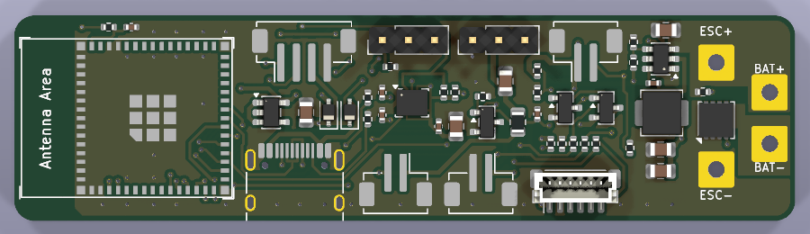
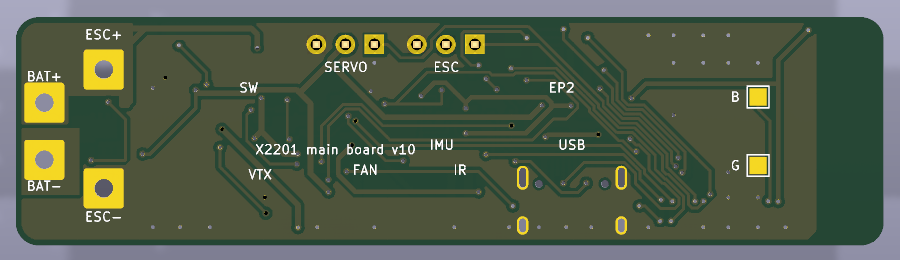

# X2201 主板 v10（階段 1）

76×20 mm，2 層，1.6 mm，零件只在正面，不打螺絲孔（由外殼固定）。電池接到主板，主板再接外接的有刷電調（**無 BEC 版**），5V 由主板自己的降壓做。方案見 [ROADMAP.md](../ROADMAP.md)。




## 接法

```
電池 → W1/W2 → Q1 防反接 ─┬→ W3/W4 → 外接電調（無 BEC）→ 260 馬達
                           ├→ U4 5V 3A 降壓（BEC）→ S3、EP2、舵機、風扇、IR
                           └→ 電量偵測、圖傳（IO6 開關）
EP2 ─CRSF→ J2 → S3 ─┬─ PWM → P2 舵機
                    └─ PWM → P1 電調訊號
J6 開關 → 降壓的 EN
陀螺儀 LSM6DS3TR-C ─I2C→ S3
```

- **電調**：RZ7886 模組，無 BEC 版（2–3S，持續 7.5A，峰值 15A）。P1 只接 S 和 G，第 2 腳（V）不接。
- **開關 J6**：短接後降壓才會啟動。馬達電流不經過開關。關掉後沒有 5V，S3 不出脈衝，電調不轉，圖傳也斷電。
- **防反接 Q1**：N-MOS 放在電池負極，drain 接 BAT−，source 接 GND。電池接反時主板和電調一起斷開。v9 把 Q1 的這兩腳接反了，v10 已改正。
- **只插 USB 時**：S3 和 EP2 有電，可以直接除錯；舵機、風扇、IR、圖傳沒有電。

## 板面配置

- 左端：ESP32-S3-MINI-1，天線朝板外，天線下方不鋪銅。EN 的 RC 在模組上緣。
- 上長邊：J2 EP2、P1 電調訊號、P2 舵機、J6 開關。
- 下長邊：J9 USB-C、J5 IR、J4 風扇、J3 圖傳。
- 右端：降壓（U4、L1、C1、C3、C4），電調和電池的焊線孔，Q1。

## 焊接

| 位號 | 內容 |
|---|---|
| W1 BAT+、W2 BAT− | 電池線，最右一排 |
| W3 ESC+、W4 ESC− | 電調電源線，內側一排 |
| P1、P2 | 2.54 mm 3 針排針 |

P1、P2 **不要裝直插排針再插舵機頭**：插上後連線約高出板面 19 mm，車殼內那個位置只有約 18 mm。把電調和舵機的線直接焊進孔裡，或者改用 90° 彎針，讓插頭平躺並伸出板邊。兩種做法焊盤都一樣，板子不用改。

焊線孔孔徑 1.25 mm。**焊電池前用萬用表確認正負極**：BAT+ 在上，BAT− 在下。背面也印了標示。

## 插座

| 位號 | 類型 | 腳位 |
|---|---|---|
| P1 電調訊號 | 2.54 3P 排針 | 1 訊號、2 不接、3 GND |
| P2 舵機 | 2.54 3P 排針 | 1 訊號、2 5V、3 GND |
| J2 EP2 | ZH1.5 4P | 1 EP2 TX、2 EP2 RX、3 5V、4 GND |
| J3 圖傳 | JST1.0（SH）6P | 1 電源、2 GND、3 圖傳 RX、4 圖傳 TX，5、6 不接 |
| J4 風扇 | ZH1.5 2P | 1 5V、2 GND |
| J5 IR | ZH1.5 2P | 1 LED+、2 LED− |
| J6 開關 | ZH1.5 2P | 1 電池、2 降壓 EN（短接＝開） |
| J9 | USB-C | 燒錄與除錯 |

排針第 1 腳是方形焊盤。背面 B、G 兩個焊盤用來救磚：短接後上電，S3 進入下載模式。

## GPIO

和 v9 相同，韌體不用改。

| GPIO | 功能 |
|---|---|
| 6 | 圖傳電源，高電位開，重開機時關閉 |
| 7 | 電調油門 PWM（10k 下拉） |
| 8 | 舵機 PWM |
| 9 | 電池電壓（×22/122） |
| 10 / 11 | 圖傳 UART RX / TX |
| 13 / 14 | CRSF RX / TX |
| 15 | IR |
| 16 / 17 / 18 | 陀螺儀 SDA / SCL / INT（I2C 位址 0x6A） |

## 尚未驗證

- 整塊板子還沒打板，也還沒實機驗證。降壓 U4 至今沒有實際上電過。
- 新的貼片方向（U1 轉 90°、Q1、U4、L1）還沒有在 JLC 的預覽裡核對。
- 裝車空間（2026-11-16，用 `x2201_liner.npz` 掃描出來的車內空間估算）：板子平放在底盤中線、順著車身縱向擺，板底離底盤 2 mm 時，除了 P1、P2 的直插排針以外都放得下，最緊的是 J3 SH 插頭，還有約 7 mm 餘量。插頭高度是估計值，沒有實測；電池、圖傳、風扇、鏡頭也要放在同一個空間，還沒一起排過。

## 重新產生

```bash
/Applications/KiCad/KiCad.app/Contents/Frameworks/Python.framework/Versions/Current/bin/python3 gen_pcb.py
```

佈線用 `../tools/freerouting-1.9.0.jar`，佈線前先畫好 `HAND_T` 裡手畫的線（USB 交叉、降壓、陀螺儀、Q1 閘極、電量、VBAT 等）。加 `REUSE_SES=1` 會沿用已存的 `.ses`。之後執行 `gen_sch.py` 更新原理圖。`FAB=1` 會輸出 Gerber、BOM 和座標檔，下單前再跑。
