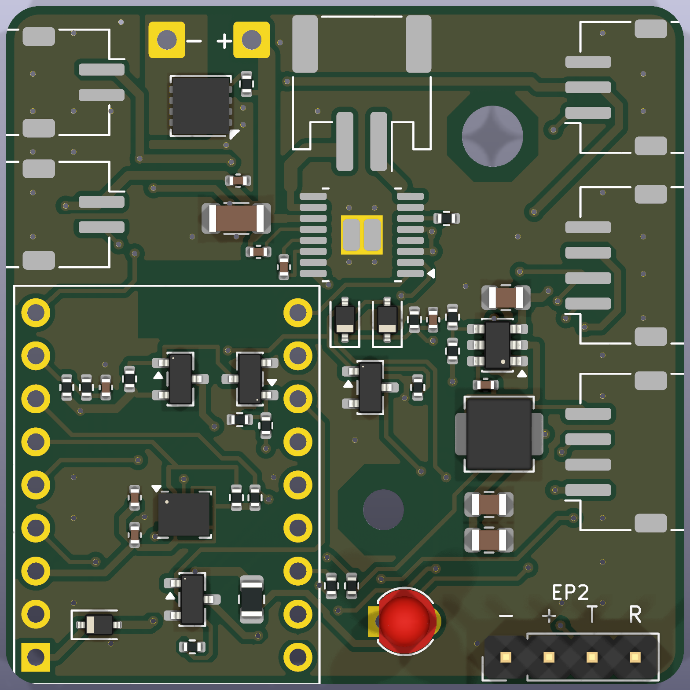
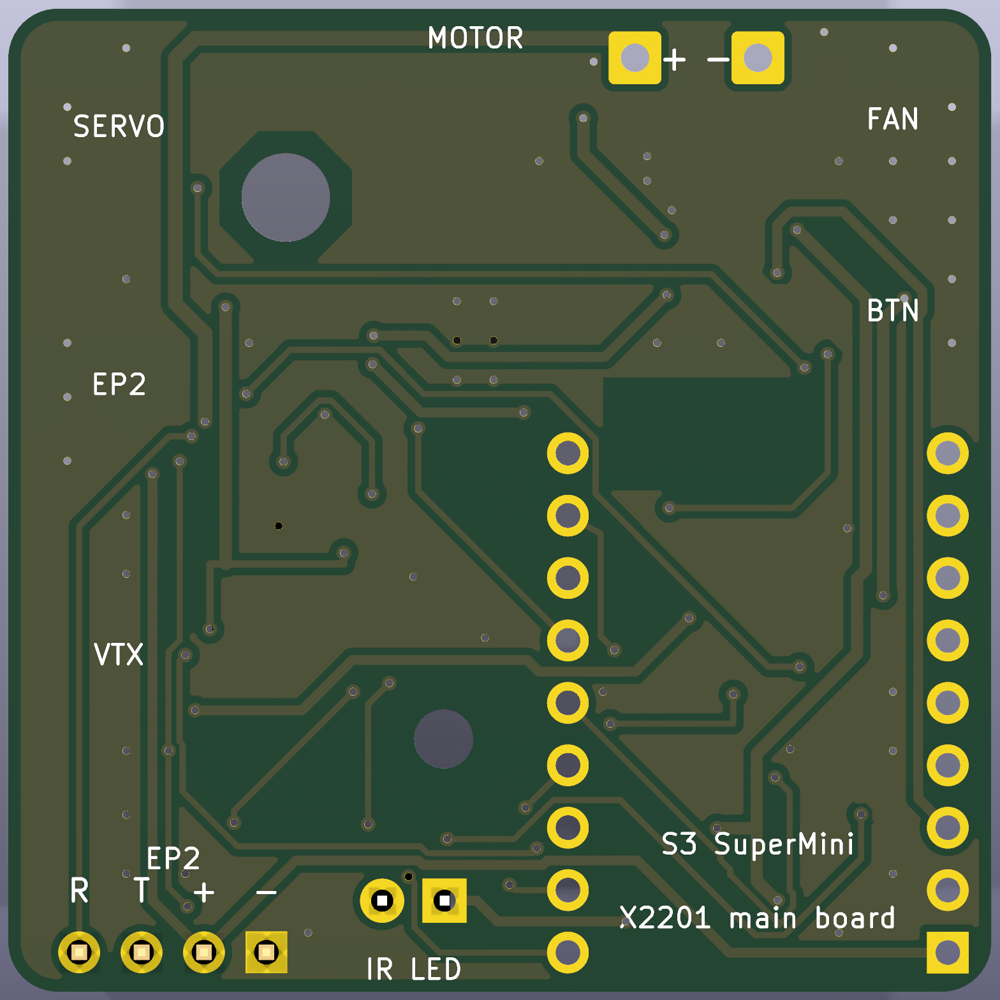

# X2201 主板

元件、電路、GPIO 和接口見 [../PLAN.md](../PLAN.md)。這裡只寫這塊板子的外形、擺位和焊接方式。

40×40 mm，2 層，1.6 mm。放在底盤 40×60 mm 的可用範圍內（沿車身 40、橫向 60）。




## 固定

座標以俯視為準：X 是橫向，Y 是沿車身，Y = 0 是車頭那邊的板邊，Y = 40 是車尾。

| 孔 | 位置 | 孔徑 | 說明 |
|---|---|---|---|
| MH1 M2 固定孔 | (22.28, 29.71)，偏車尾 | 2.4 mm 不鍍銅 | 鎖在底盤 M2 凸台上（凸台外徑 4.95），唯一的固定點 |
| MH2 定位孔 | (28.71, 7.68)，靠車頭 | 3.6 mm 不鍍銅 | 定位柱頂端的 3.5 插進來，不鎖螺絲 |

兩孔沿車身相距 22.02、橫向相距 6.43。2026-11-17 用 3D 列印的假板（`firmware/wheel-esp32/enclosure/out/x2201_mainboard_dummy_27.stl`）在車上試裝確認。M2 凸台和定位柱頂面一樣高，板子平放在兩者上，不用墊。兩孔周圍 ±2.7 mm 不鋪銅、不放零件。

## 擺位

- 左側、車尾：SuperMini，USB-C 從車尾板邊伸出。它底下（零件最高 1.1 mm）有陀螺儀、電量分壓、D3，天線後面是圖傳電源開關（Q2、Q3），靠車尾那端是 IR LED 的驅動（Q4、R6、R8）。SuperMini 朝車頭那端是晶片天線，底下不鋪銅。
- 車頭板邊：BAT− / BAT+ 焊盤（左邊是 −、右邊是 +）、Q1 防反接、J7 馬達插座（插口朝車頭）。
- 中間：DRV8874 電調（緊貼馬達插座後面）、5V 降壓、按鈕電路、圖傳開關。
- 右板邊（插口朝外）：從車頭到車尾依序是 P2 舵機、J2 EP2、J3 圖傳。
- 車尾板邊：SuperMini 右邊是計圈用的 IR LED（D6，3 mm 直插）；右後角是 J8，4 個 2.54 mm 排針孔，讓 EP2 直接焊上、伸出車尾板邊（那裡沒有金屬遮擋）。J8 和 J2 接的是同一組訊號，兩個擇一用。
- 左板邊、車頭段（插口朝外）：J4 風扇、J6 按鈕。

## 焊接

JLC 貼正面所有的貼片零件，插座也包括在內。D6 紅外 LED（億光 IR204/H60，LCSC C60099，3 mm 直插）也放進 BOM，下單時要選插件（THT）焊接；不想付插件費的話，在 BOM 裡刪掉 D6 那一行自己焊。D6 立著焊、朝上，要換別的 LED 時，短腳（陰極）插方形焊盤。以下自己焊：

| 位號 | 內容 |
|---|---|
| U1 | ESP32-S3 SuperMini，兩排 9 針排針。**要用排針墊高約 2.5 mm，不能貼平焊**，底下有零件。方形焊盤是 5V 腳 |
| BAT+ / BAT− | 電池線，20 AWG，鑽孔 1.15 mm，在車頭板邊 |
| J8 | EP2 直焊孔。EP2 元件面朝上、焊盤那一邊朝主板、本體伸出車尾。從左到右：1 GND、2 5V、3 EP2 的 TX、4 EP2 的 RX（正反面印 −、+、T、R），剛好對上 EP2 焊盤（元件面朝上、焊盤朝自己時，由左到右是 RX、TX、5V、GND）。J8 腳距 2.54，焊之前量一下 EP2 焊盤的間距 |

**焊電池前先用萬用表確認正負極**。俯視時 BAT− 在左、BAT+ 在右，正反面都有標示。

## 下單前要確認

- U2 陀螺儀是 LSM6DSV16X（ST，C5267406），只能用**標準型**貼片（這個系列都一樣），下單時選標準型 PCBA。它在 SuperMini 正下方，下單後沒辦法自己換。
- D4 換成了另一顆料（1N4148WS，C2128），JLC 的 3D 模型可能不同，預覽裡要重看 D4。正確方向：D3 色帶（陰極）朝左板邊，也就是朝 SuperMini 的方形焊盤；D4、D5 色帶朝車尾，背向 DRV8874。
- 如果 JLC 要加工藝邊，選上下（車頭、車尾），不要選左右：左右兩邊的側插插座本體超出板邊約 0.1 mm。
- J2、J3 都是 ZH1.5 4P，插錯會燒壞 EP2 或圖傳；J4、J6 都是 2P。線材要做記號。
- 只能焊 SuperMini。備用的 S3-Zero 孔位一樣，但 5V、GND、3V3 在另一排，直接焊上去會燒，見 PLAN.md。
- 在 JLC 預覽裡，每顆有方向的零件（Q1–Q6、U2、U4、U5）的粉紅色第 1 腳圓點，都要落在絲印三角形那一角。
- D6 在預覽裡，LED 的「+」（陽極、長腳）要在右邊的圓形焊盤，「−」在左邊的方形焊盤。
- 在 JLC 的貼片預覽裡核對側插插座（P2、J2、J3、J4、J6、J7）、Q1、U4、U5、L1 的方向，插座的插口要朝板外。SOT-23（Q2、Q3、Q4、Q6）和 B5819WS（D3、D5）的角度修正是 v8 時在預覽裡核對過的。D4 換成 1N4148WS 後，JLC 用的是另一個 3D 模型，零度方向和 B5819WS 差 180°，CPL 已單獨修正，預覽裡還是要看一次（見本節第一條）。

## 下一版要改

這一版先不動佈局，下一版再改：

- D5 和 EN 之間串約 22k，根治只插 USB 時 EN 超過規格的問題。
- 地線有瓶頸，要多加 GND 過孔：
  - 馬達回流從頂層主地只經 2 個過孔到底層，再經 3 個過孔到 Q1 的 source。
  - C16（VM 的 100nF）的地在 Q1 那一小塊，離 PGND 很遠。
  - U4 的 GND 腳要經 1 + 1 個過孔才回到主地。
  - SuperMini、陀螺儀、IR 驅動的地，只靠一條 0.3 mm 的線接回主地。
- 可選：R26 改 2.2k，ITRIP 約 3.3A，比較接近 J7（PH2.0）的 2A 額定，也比較不會進過熱保護。

## 檔案

- `gen_pcb.py` 產生佈局，`gen_sch.py` 從佈局產生原理圖，兩邊的網路名稱一致。
- `x2201-mainboard-gerber.zip`、`bom.csv`、`cpl.csv` 是下單 JLC 用的檔案。

```bash
/Applications/KiCad/KiCad.app/Contents/Frameworks/Python.framework/Versions/Current/bin/python3 gen_pcb.py
```

佈線用 `../tools/freerouting-1.9.0.jar`。佈線前會先畫好 `HAND_T` 裡手畫的線（降壓、陀螺儀、DRV8874 的馬達輸出、VM、接地、IR）。加 `REUSE_SES=1` 會沿用已存的 `.ses`，`FAB=1` 會輸出 Gerber、BOM 和 CPL。之後執行 `gen_sch.py` 更新原理圖。
